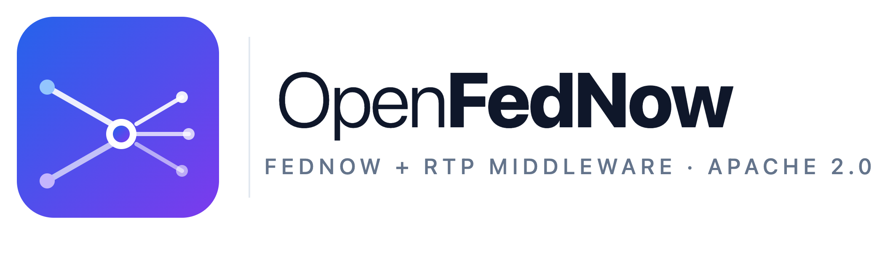
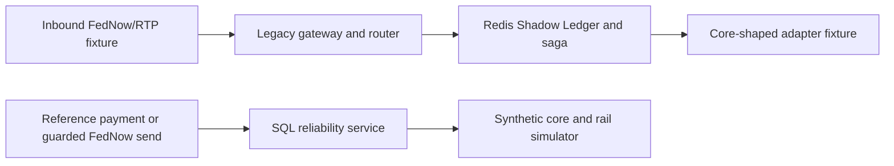

<p align="center">
  
</p>

# OpenFedNow

**Open-source failure tests and reference code for sending U.S. instant payments from an existing bank core.**

[](LICENSE)
[]()
[]()
[]()
[](https://doi.org/10.5281/zenodo.21114113)

> **Independent project.** OpenFedNow is not affiliated with, endorsed by, or connected to the Federal Reserve Banks, the FedNow Service, The Clearing House, or any core banking provider. It does not connect to a live payment network. See [Trademarks and affiliation](#trademarks-and-affiliation).

## What it does

An instant payment moves money between banks in seconds, and settlement is final. The software between a bank's core system and the payment service has to stay correct when something fails in the middle of a payment. OpenFedNow tests three sending-side failures:

| Situation | What can go wrong | What the test checks |
|---|---|---|
| **Lost confirmation** (S02). The bank sends a payment and no reply comes back. | Sending again pays twice. Assuming success hides a payment that never settled. | The funds stay on hold, the status is checked, and exactly one debit is recorded. |
| **Repeated request** (S06). The same payment instruction arrives twice. | Two payments leave for one instruction. | The repeat returns the original payment, with one submission. |
| **Competing payments** (S16). Two payments draw on the same balance at once. | Both are approved against money that covers only one. | The first payment reserves the funds and the second is refused. |

The repository contains three things:

- **A test kit.** The [Portable Send Reliability Profile v1](docs/reliability/portable-send-profile.md) defines the scenarios and the results a correct system must produce. You connect it to your own test system through a small [driver](harness/contract-v1.md).
- **Reference code.** A Java service and a separate Python implementation that pass the tests, so you can read and run one working answer.
- **Published evidence.** For each evaluation, the [commands, source version and raw results](docs/reliability/evidence/).

## Try it in five minutes

You need Python 3.9 or later. No Java build, Docker or third-party packages are required.

```sh
git clone https://github.com/danielsmori/open-fednow.git
cd open-fednow
python3 harness/smoke_profile.py --case S02
```

The command prints `S02: PASS` and writes a report to `target/portable/send-v1-smoke.json`. It starts a reference target and a separate payment-service simulator on local ports, runs the lost-confirmation test and stops both. Run all four cases with:

```sh
python3 harness/smoke_profile.py --all
```

## Run the tests against your own system

1. Read the [driver contract](harness/contract-v1.md) and copy [`harness/example_target_driver.py`](harness/example_target_driver.py).
2. Implement the driver methods for your test system. Use synthetic accounts only.
3. Run the profile as described in the [profile guide](docs/reliability/portable-send-profile.md).
4. Report what happened, including failures and anything you could not reproduce. Open a **Reproduction report** issue or use the [evaluator feedback form](docs/reliability/evaluator-feedback-form.md).

The [evaluator guide](docs/reliability/evaluator-guide.md) explains each step in more detail.

<a id="payment-integration-walkthrough"></a>

## See it in a browser

From a clean checkout, with JDK 17, Maven, Python 3 and a running Docker daemon, use **one startup command**:

```bash
./demo/payment-integration.sh
```

Open `http://127.0.0.1:18080/demo/console.html` and choose **Payment Integration · synthetic**. **Normal payment** sends $100 through the guarded, non-production `/fednow/send` bridge. **Lost confirmation** makes the separate rail simulator record settlement and drop the HTTP reply. Click **Repeat same request** to retrieve the same operation, then **Check status / inquire** to advance the synthetic inquiry clock and observe resolution. The console reads the operation ID and local state from the Java service, booked balance and hold from its PostgreSQL synthetic core fixture, and submission count and rail status from the separate SQLite-backed simulator. It does not infer those figures from button clicks. The console uses the local fixture administrator credentials (`admin:changeme`) and should be used only on a trusted local machine.

For a command-line check of both flows while the stack is running, use `python3 demo/verify-payment-integration.py`; it writes service and simulator observations to `target/payment-integration/verification.json`. Press Ctrl+C in the startup terminal to stop the Java service and simulator and remove the demo's disposable Docker containers. The script uses dedicated ports 18080, 18099, 55432, 56379 and 55672, checks for conflicts before startup, and deletes only this demo's container state and simulator file. **Both core and rail are synthetic.** This walkthrough does not use FedNow transport, an institution core, vendor credentials, or live settlement evidence.

## Current status

| Component | Status |
|---|---|
| Test kit | [Portable Send Reliability Profile v1](docs/reliability/portable-send-profile.md): ordinary payment, lost confirmation, repeated request and competing payments. |
| Reference code | Java service with durable payment records, fund holds, duplicate-request controls and recovery by status inquiry. A separate Python implementation follows the same rules. |
| Evaluations | [October 1, 2026 practical evaluation](docs/reliability/practical-evaluation-2026-10-01.md) and the dated bundles in [`docs/reliability/evidence/`](docs/reliability/evidence/). |
| Independent ledger | The unchanged competing-payments test runs against [TigerBeetle](docs/reliability/tigerbeetle-s16.md). |
| Check comparison | A [reproducible comparison](docs/reliability/s02-ledger-rail-comparison.md) runs the lost-confirmation test against two synthetic targets and scores a status-only check, an independent ledger-and-rail checklist and the test kit's evaluator. |
| Provider interface | A [read-only adapter](docs/integrations/fiserv-banking-hub.md) for Fiserv's Banking Hub trial environment. |

The full list of components is in [docs/status.md](docs/status.md). Development history and open work are in [docs/roadmap.md](docs/roadmap.md) and [CHANGELOG.md](CHANGELOG.md).

## Scope and limits

OpenFedNow is a sandbox and reference implementation. Its results come from synthetic accounts and a simulated payment service.

- **Evaluation scope: synthetic FedNow routing.** Outbound RTP is disabled; screening failures reject by default; downtime sends default to disabled. On the legacy path, an unknown outbound rail outcome keeps the reservation and requires review. The separate SQL reliability path adds synthetic status inquiry and recovery; live status authority remains unverified. See the [capability matrix](docs/capability-matrix.md), [current practical evaluation](docs/reliability/practical-evaluation-2026-10-01.md), and [September candidate report](docs/reliability/evaluation-report.md).
- **Sandbox / reference implementation.** Routing, vendor-shaped adapters, saga lifecycle, idempotency, reconciliation, screening, cancellation, rate limiting, and admin audit have synthetic test coverage. Passing tests do not establish atomic money movement across Redis and SQL, live rail connectivity, vendor compatibility, or production readiness. See [reliability scope](docs/reliability/scope.md), [docs/known-limitations.md](docs/known-limitations.md), and [Production Boundaries](#production-boundaries).

Passing these tests does not certify an institution for the FedNow Service or any other network. FedNow's own participant testing and certification process applies to every participant.

## Quick start: the full Java service

Requires JDK 17+, Maven and Docker with Compose. The default application profile uses PostgreSQL, Redis and RabbitMQ from `docker-compose.yml`:

```sh
git clone https://github.com/danielsmori/open-fednow.git
cd open-fednow
python3 scripts/preflight.py          # checks JDK 17, Maven, Python, Docker and the host ports
docker compose up -d postgres redis rabbitmq
mvn spring-boot:run
```

Container and volume names are scoped to the Compose project, so a second checkout can run its own stack with `docker compose -p <name> up -d`. The published host ports default to the standard ones and move with `POSTGRES_PORT`, `REDIS_PORT`, `RABBITMQ_PORT` and `RABBITMQ_MANAGEMENT_PORT`; they bind `127.0.0.1` only.

To run the service in a container instead of on the host, add `compose.app.yml`:

```sh
python3 scripts/preflight.py --mode app
docker compose -f docker-compose.yml -f compose.app.yml up -d --wait
curl http://127.0.0.1:8080/fednow/health
```

That builds the image from this checkout. To run a published release instead, which is multi-arch and runs natively on Apple Silicon as well as x86, name it and skip the build:

```sh
OPENFEDNOW_IMAGE=ghcr.io/danielsmori/open-fednow:0.1.0 \
  docker compose -f docker-compose.yml -f compose.app.yml up -d --wait --no-build
```

In that mode the service reaches PostgreSQL, Redis and RabbitMQ by name inside the Compose network, so only the service's own port is published, on `127.0.0.1`. `APP_PORT` moves it, which lets two checkouts run the whole stack at once. This is a synthetic local stack: no live FedNow rail, no core banking system, and the non-production fixture gates stay off. The recorded reliability evidence is produced against the service running on the host, not this container; see [ADR-0011](docs/adr/0011-evaluate-the-host-run-jvm.md).

The local health route is `http://localhost:8080/fednow/health`; `http://localhost:8080/demo/` is a synthetic browser demonstration. The optional `./demo/run-demo.sh` exercises legacy outbound and return examples and requires starting the app with `LEGACY_OUTBOUND_SANDBOX_ENABLED=true LEGACY_RETURN_SANDBOX_ENABLED=true` in a **local sandbox**. Those routes are disabled by default. The reliability bridge is a separate opt-in non-production path; see [reproduction instructions](docs/reliability/reproduce.md).

Default tests run without Docker; tagged integration tests require Docker:

```sh
mvn test
mvn test -Dgroups=integration -DexcludedGroups=
```

The [September 29 evaluation report](docs/reliability/evaluation-report.md) records the exact tested source and results. Its full external evaluator runs with `python3 scripts/evaluate.py --integration --negative-control --external` after starting the Compose dependencies.

## Architecture

The legacy inbound reference route passes a gateway message to the shared router, core-shaped adapter, Redis Shadow Ledger and saga/reconciliation components. The outbound RTP route and legacy FedNow send/return effects are disabled by default. A separate SQL reliability service owns synthetic outbound holds, attempt intents and final financial effects; the guarded `/fednow/send` evaluation bridge delegates to that service without calling the legacy router or vendor adapters.



Neither branch represents a certified live rail integration. See [current architecture](docs/architecture.md) and [reliability architecture](docs/reliability/architecture.md).

## ISO 20022-shaped models

The repository contains selected `pacs.008`, `pacs.002`, `pacs.004`, `camt.056` and `camt.029` Java models. Local fields and serialization tests do not establish a complete FedNow, RTP or PIX message profile. The SQL reliability harness uses a smaller JSON protocol that is not a FedNow transport or pacs.028 mapping. See [message mapping boundaries](docs/iso20022-mapping.md).

## Architectural Background

PIX, FedNow, and RTP all raise legacy-to-real-time integration questions, but their rules, messages, access, and controls differ. This repository is an independent synthetic implementation; it does not disclose or verify any person's work on a proprietary PIX platform.

## Repository map

| Path | Purpose |
|---|---|
| `src/main/java/io/openfednow/gateway/` | Inbound reference gateways and guarded outbound entry points |
| `src/main/java/io/openfednow/reliability/` | Synthetic SQL payment ownership, holds, inquiry and recovery |
| `src/main/java/io/openfednow/acl/` | Core-shaped interface and locally tested adapters |
| `src/main/java/io/openfednow/shadowledger/` | Legacy Redis ledger and reconciliation experiment |
| `src/main/resources/db/migration/` | Additive Flyway migrations V1–V12 |
| `harness/` | External scenario contract, independent rail simulator and separate Python target |
| `docs/reliability/` | Scope, architecture, capability matrix, reproduction and evidence |
| `.github/workflows/` | CI and dependency scanning |

## Production Boundaries

The repository contains reference implementations and synthetic tests. Remaining work includes internal correctness gaps as well as external onboarding dependencies:

- **Submission uncertainty:** the new `/reference/v1/payments` synthetic path persists scoped ownership, a hold and attempt intent in SQL, exposes pending lookup, and can reconcile against its separate simulator. The legacy `/fednow/send` and `/fednow/return` effects are disabled by default because their cross-store/core and return controls remain unsafe. An explicit non-production evaluation flag can instead route `/fednow/send` through the same SQL reliability service as `/reference/v1/payments`; an independent sandbox-only flag retains the old demonstration. None of these paths maps to live FedNow without restricted specifications and institution controls.
- **Outbound RTP:** disabled until screening, reservations, idempotency, and reconciliation are validated on its actual routing path.
- **Rail connectivity:** actual transports, message profiles, credentials, certification, and institution-specific operational controls require verification. A configured HTTP client is not certification.
- **Vendor adapters:** mock-tested request construction is not vendor verification or confirmed compatibility.
- **Screening and downtime:** rule-based screening is optional and is not an AI or sanctions engine. A configured screen's timeout/error rejects by default; downtime sends default to disabled. Cross-channel balance correctness remains unproven.

See [capability matrix](docs/capability-matrix.md) for the boundary of each claim.

## Known Limitations

See [docs/known-limitations.md](docs/known-limitations.md) for the full analysis. Key architectural boundaries:

- **Cross-store consistency remains unverified.** Redis WATCH detects changes by other clients, but Redis balance updates and SQL audit writes do not form one atomic transaction. See [known limitations](docs/known-limitations.md).
- **Admin credentials default to `admin` / `changeme` in dev / sandbox.** A `@PostConstruct` check in `SecurityConfig` refuses to start the application under `spring.profiles.active=prod` if `ADMIN_USERNAME` / `ADMIN_PASSWORD` are still at their defaults, so a misconfigured production deployment fails loud at boot rather than silently shipping with default credentials.
- **Post-reconciliation returns remain an unverified design.** The sandbox models a return after a provisionally accepted transaction, but the deployed/live effect and legal or customer-visible outcome have not been established. The return gateway is disabled by default; see [ADR-0003](docs/adr/0003-provisional-acceptance-acsp.md).
- **Outbound camt.056 not yet implemented.** Inbound cancellation handling is complete (camt.056 → camt.029 with state-keyed decision matrix). Initiating a cancellation against our own outbound payment is tracked as future work.

## Roadmap

Completed phases and open work are listed in [docs/roadmap.md](docs/roadmap.md). Release notes are in [CHANGELOG.md](CHANGELOG.md).

## Contributing

Contributions are welcome. See [CONTRIBUTING.md](CONTRIBUTING.md) for guidelines.

Areas where contributions are especially valuable:
- Core banking vendor adapter implementations
- ISO 20022 message validation
- Test coverage for Saga compensation logic
- Documentation and integration guides

Please also read the [Code of Conduct](CODE_OF_CONDUCT.md), the [governance notes](GOVERNANCE.md) and the [security policy](SECURITY.md).

## Citing

**The software.** Cite the repository, https://github.com/danielsmori/open-fednow, with the [release](https://github.com/danielsmori/open-fednow/releases) tag you used (for example `v0.1.0`), or the commit hash if you used an untagged checkout. Citation metadata is in [CITATION.cff](CITATION.cff), and GitHub's **Cite this repository** button reads it. The software does not have its own DOI. Use the commit-specific [evaluation report](docs/reliability/evaluation-report.md) to assess a particular checkout.

**The paper.** The architecture preprint, *Bridging Legacy Core Banking to Both U.S. Instant Payment Rails: FedNow and RTP*, has its own DOI: [10.5281/zenodo.21114113](https://doi.org/10.5281/zenodo.21114113). That DOI identifies the preprint dated May 13, 2026, not this repository. The revised version of November 9, 2026 is in [docs/whitepaper.pdf](docs/whitepaper.pdf).

## License

This project is licensed under the **Apache License 2.0**. See [LICENSE](LICENSE) for the full text.

Apache 2.0 permits reuse under its stated terms; it does not establish suitability for any institution's payment operations.

## Trademarks and affiliation

OpenFedNow is an independent open-source project maintained by Daniel Stelzer Mori. It is not affiliated with, sponsored by, or endorsed by the Federal Reserve Banks, the Board of Governors of the Federal Reserve System, The Clearing House, Fiserv, FIS, Jack Henry, TigerBeetle or any other organization named in this repository.

"FedNow" is a service mark of the Federal Reserve Banks. "RTP" is a service mark of The Clearing House Payments Company L.L.C. Other names are the property of their respective owners and are used only to describe the systems this project studies. See [NOTICE](NOTICE).

## References

- Federal Reserve. [FedNow Service](https://www.frbservices.org/financial-services/fednow). Federal Reserve Financial Services, 2023.
- Federal Reserve Bank of Kansas City. *Market Structure of Core Banking Services Providers*. March 2024.
- U.S. Faster Payments Council / Finzly. *Faster Payments Barometer*. 2024.
- ISO 20022. [Financial Services — Universal Financial Industry Message Scheme](https://www.iso20022.org). International Organization for Standardization.
- Banco Central do Brasil. [PIX — Sistema de Pagamentos Instantâneos](https://www.bcb.gov.br/estabilidadefinanceira/pix). 2020.
